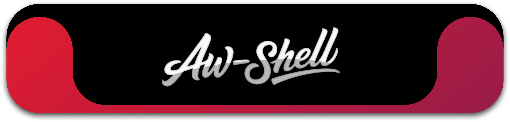
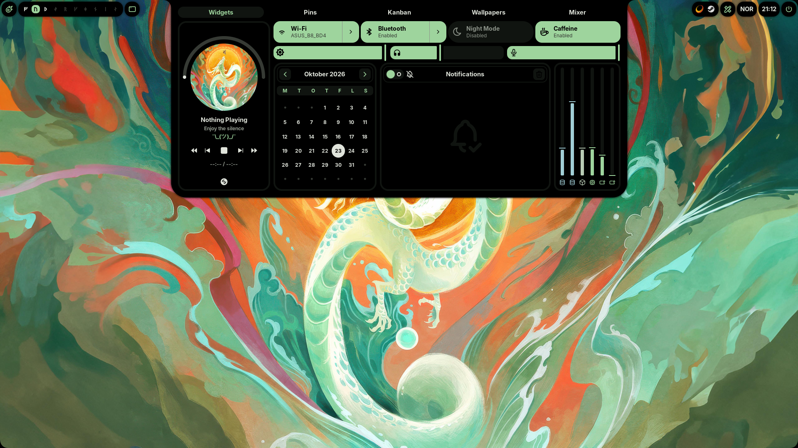
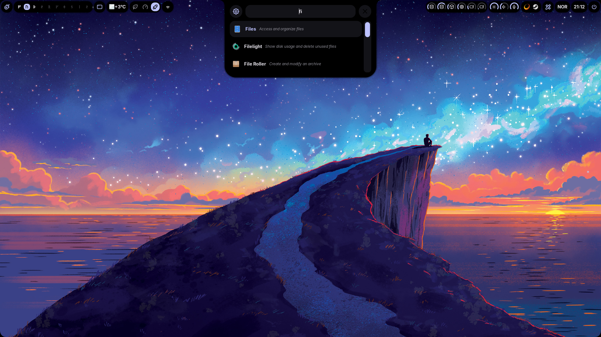
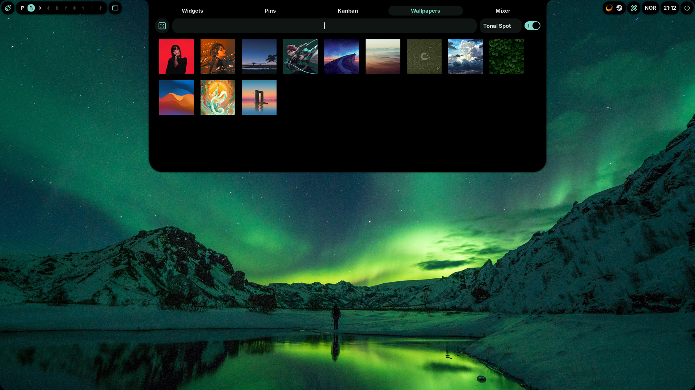
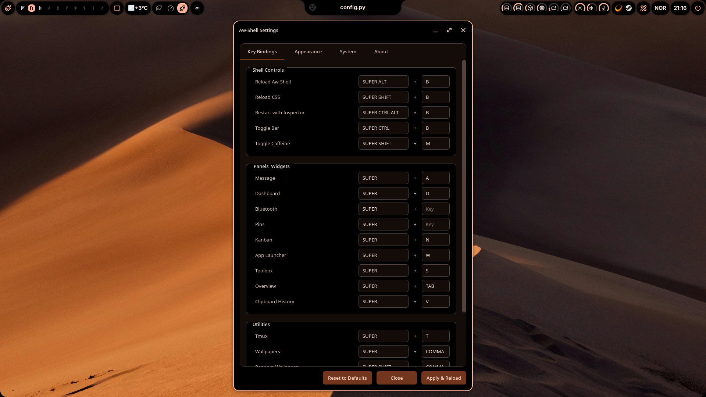

<p align="center">
<a href="https://github.com/awareness10/Aw-Shell">
  
  </a>
</p>

<p align="center">
  <sub><sup></sup></sub>
  <a href="https://github.com/hyprwm/Hyprland"></a>
  <a href="https://github.com/Fabric-Development/fabric/"></a>
  <sub><sup></sup></sub>
</p>

<p align="center">
  <a href="https://github.com/awareness10/Aw-Shell/actions/workflows/test.yml"></a>
  <a href="https://github.com/awareness10/Aw-Shell/actions/workflows/test.yml"></a>
</p>

> Forked from [Axenide/Ax-Shell](https://github.com/Axenide/Ax-Shell) - A hackable shell for Hyprland

---

## Table of Contents

- [Screenshots](#screenshots)
- [Installation](#installation)
  - [Supported systems](#supported-systems)
  - [AUR](#aur)
  - [Install script](#install-script)
  - [Manual Installation](#manual-installation)
  - [Where Aw-Shell keeps its files](#where-aw-shell-keeps-its-files)
  - [Updating from an older version](#updating-from-an-older-version)
  - [Uninstalling](#uninstalling)
- [Features](#features)
- [Testing](#testing)
  - [Running](#running)
  - [The GTK sandbox](#the-gtk-sandbox)
  - [CI](#ci)
  - [Limitations](#limitations)
- [Changes from Ax-Shell](#changes-from-ax-shell)

---

<h2 id="screenshots"><sub></sub> Screenshots</h2>
<table align="center">
  <tr>
    <td width="50%"></td>
    <td width="50%"></td>
  </tr>
  <tr>
    <td width="50%"></td>
    <td width="50%"></td>
  </tr>
</table>

<p align="center"><sub>Colors follow the wallpaper via matugen. Aurora by <a href="https://unsplash.com/photos/snow-mountain-with-aurora-borealis-EvKBHBGgaUo">Jonatan Pie</a> and dunes by <a href="https://unsplash.com/photos/a-large-sand-dune-in-the-middle-of-a-desert-hoT_2bL5LxU">Tim Arterbury</a> on Unsplash.</sub></p>

<h2 id="installation"><sub></sub> Installation</h2>

### Supported systems

| System | Status |
|---|---|
| Arch Linux | Supported |
| CachyOS | Supported (used daily) |
| Other distros on Arch's own repositories (e.g. EndeavourOS) | Expected to work, not tested |
| Manjaro | Untested: its delayed repositories can clash with the AUR packages |
| Non-Arch distros (Debian, Ubuntu, Fedora, NixOS, ...) | Not supported |

Requirements:
- Hyprland 0.56.2 or newer
- [uwsm](https://github.com/Vladimir-csp/uwsm): the installer and the generated Hyprland config launch the shell with `uwsm app`
- `pacman` with access to the AUR; the installer uses `paru` or `yay` and installs `yay-bin` if neither is present. fabric-cli only exists in the AUR. Gray (fabric's system tray library) has no working package, so the installer builds it into `~/.local/lib/aw-shell`
- systemd

> [!NOTE]
> The installer enables NetworkManager if it is not already enabled, and disables `iwd` if it is running.

### AUR

```bash
paru -S aw-shell    # or: yay -S aw-shell
```

Then run `uwsm app -- aw-shell` once. Its settings window opens; applying it adds Aw-Shell to your `hyprland.lua`, so it starts with Hyprland from then on. Updates come with your AUR helper, and `pacman -R aw-shell` removes it while keeping your settings.

### Install script

> [!TIP]
> This command also works for updating an existing installation!

**Run the following command in your terminal once logged into Hyprland:**
```bash
curl -fsSL https://raw.githubusercontent.com/Awareness10/Aw-Shell/main/install.sh | bash
```

It installs the code into `~/.local/src/aw-shell` (set `AW_SHELL_DIR` to choose another folder) and starts the shell, which opens its settings the first time. From a clone of the repository, `./install.sh --dev` runs Aw-Shell from that clone instead.

### Manual Installation

1. Install [uv](https://docs.astral.sh/uv/):
    ```bash
    curl -LsSf https://astral.sh/uv/install.sh | sh
    ```

2. Install system dependencies (Arch Linux):
    - [fabric-cli](https://github.com/Fabric-Development/fabric-cli)
    - [Gray](https://github.com/Fabric-Development/gray): its AUR package can't install, so build it into `~/.local/lib/aw-shell`, where Aw-Shell looks for it: `source install.sh && build_gray` (needs `meson` and `vala`)
    - [Matugen](https://github.com/InioX/matugen)
    - `awww` `brightnessctl` `cava` `cliphist` `ddcutil`
    - `bluez-utils` `gobject-introspection` `gpu-screen-recorder` `headsetcontrol`
    - `hypridle` `hyprlock` `hyprpicker` `hyprshot` `hyprsunset`
    - `imagemagick` `libnotify` `networkmanager` `network-manager-applet`
    - `nm-connection-editor` `noto-fonts-emoji` `nvtop` `playerctl`
    - `power-profiles-daemon` `swappy` `tesseract` `tesseract-data-eng`
    - `tesseract-data-spa` `tmux` `upower` `uwsm`
    - `webp-pixbuf-loader` `wl-clipboard`

3. Clone, install Python deps, and run (any folder works; `~/.config/aw-shell` is for your settings):
    ```bash
    git clone https://github.com/Awareness10/Aw-Shell.git ~/.local/src/aw-shell
    cd ~/.local/src/aw-shell
    uv sync
    uwsm app -- .venv/bin/python main.py > /dev/null 2>&1 & disown
    ```

### Where Aw-Shell keeps its files

The code never changes while the shell runs, so it can live in a read-only folder. Everything the shell writes follows the [XDG Base Directory](https://specifications.freedesktop.org/basedir-spec/latest/) folders:

| Folder | What's in it |
|---|---|
| `~/.local/src/aw-shell` | The code (the install script's clone) |
| `~/.config/aw-shell` | Your settings (`config/config.json`), the dock's pinned apps, the generated Hyprland config and the wallpaper's colors |
| `~/.local/share/aw-shell` | Kanban board and pins |
| `~/.local/state/aw-shell` | Calculator and unit-conversion history |
| `~/.cache/aw-shell` | Icon cache and wallpaper thumbnails; safe to delete |
| `$XDG_RUNTIME_DIR/aw-shell` | Notification history and other files for the current session |

To change the look without editing the code, create `~/.config/aw-shell/styles/user.css`. It loads after the built-in styles, so its rules win, and `SUPER SHIFT + B` reloads it.

### Updating from an older version

Older versions kept the code and your settings together in `~/.config/aw-shell`. The install script moves such an install to `~/.local/src/aw-shell` and keeps your settings; the in-app updater runs it for you. Your kanban board, pins and history move to their new folders on the next start.

To move it by hand, run `.venv/bin/python main.py --migrate` from the new location. It never deletes or overwrites anything: an old install it can't move is kept as `~/.config/aw-shell.bak-<date>`.

### Uninstalling

```bash
~/.local/src/aw-shell/uninstall.sh
```

It removes the code, the cache and the line in your Hyprland config, then asks before deleting your settings, kanban board, pins and history.

<h2 id="features"><sub></sub> Features</h2>

- App Launcher
- Bluetooth Manager
- Caffeine / Idle Control
- Calculator
- Calendar
- Clipboard Manager
- Color Picker
- Customizable UI
- Dashboard
- Dock
- Headset & Mouse Battery
- Emoji Picker
- Kanban Board
- Network Manager
- Notifications
- OCR
- Pins
- Power Manager
- Power Menu
- Screen Recorder (with recording indicator)
- Screenshot
- Settings
- System Tray
- Terminal
- Tmux Session Manager
- Update checker
- Vertical Layout
- Wallpaper Selector
- Weather
- Workspaces Overview
- Multi-monitor support

<h2 id="testing"><sub></sub> Testing</h2>

There are two test suites. They must run in separate processes: `tests/` replaces `gi` with mocks, `tests_gtk/` needs the real one.

| Suite | What it covers | How |
|---|---|---|
| `tests/` | Logic: settings, config generation, monitor mapping, layout, conversions, updater, weather | `gi`, GTK and parts of fabric are mocked in `tests/conftest.py`; PySide6 runs offscreen; runs in a temporary `HOME`, so your own config doesn't affect results |
| `tests_gtk/` | Widgets built against real GTK/fabric: build smoke tests for the bar, notch, dock and most panels, plus notifications, overview, metrics, system tray | Runs inside a sandbox (see below) |

### Running

```bash
uv sync                       # includes the dev group (pytest, pytest-cov, ruff)
uv run pytest                 # unit tests (tests/)
uv run pytest tests_gtk       # GTK tests, needs sway plus the shell's system deps (see below)
scripts/test-gtk.sh --all     # both suites in Docker, exactly like CI, merged coverage
scripts/test-gtk.sh           # GTK tests only, in Docker
uv run ruff check .           # lint
uv audit --preview-features audit-command   # known vulnerabilities in locked dependencies
```

Running `tests_gtk` locally needs `sway` (`pacman -S sway`) and the libraries the shell itself uses (e.g. gtk-layer-shell, Gray, NetworkManager and playerctl typelibs); with a working Aw-Shell install, only sway is missing. Without them, use the Docker script.

Coverage is on by default (`--cov` in `pyproject.toml`). Use the local runs while working, and the Docker run before pushing: it uses Ubuntu 24.04 like CI, so results can differ from Arch, which ships newer libraries.

### The GTK sandbox

`tests_gtk/conftest.py` sets everything up before anything imports `gi`, so the tests never touch your running session:

- a private **headless sway** as the Wayland compositor (it has the layer-shell protocol fabric needs). Nothing appears on screen, and sway doesn't need seatd/polkit setup for this
- a private **D-Bus** session/system bus with a fake UPower (`fake_upower.py`)
- fake **Hyprland** IPC sockets and a `hyprctl` stub (`fake_hyprland.py`)
- a temporary `HOME`/XDG dirs with an empty `~/.config/aw-shell`, like a fresh package install. The Docker script mounts the code read-only, so a test that writes next to the code fails
- stubs for commands with side effects (`systemctl`, `pkill`, `matugen`, `notify-send`, ...), which log their arguments instead of running (read them with `sandbox.commands()`)

`test_sandbox.py` checks the isolation itself. Everything is cleaned up when the run ends, including after a failed start.

### CI

`.github/workflows/test.yml` runs `scripts/test-gtk.sh --all` on pushes to `main`/`dev` and on pull requests to `main`. On push, the merged coverage is published to the `badges` branch for the coverage badge above.

`.github/workflows/audit.yml` runs `uv audit` on the same pushes and weekly on `main`, since advisories appear without any change here. Advisories that don't apply are listed under `[tool.uv.audit]` in `pyproject.toml`, with the reason.

### Limitations

- **Coverage is split by design.** Plain `uv run pytest` reports only what the unit tests reach, so it looks low; the real number is the merged one from `scripts/test-gtk.sh --all`, which is what the badge shows.
- **Smoke tests check that widgets build, not how they look or behave in depth.** Only a few modules have behaviour tests (`test_notification_popup`, `test_overview`, `test_metrics`, `test_systemtray`, `test_wallpapers`, `test_wayland`).
- **Some code is only reached by the smoke tests or not at all,** e.g. the UPower client and Bluetooth service are partly covered, global keybinds and the tooltip helper not at all.
- **Real hardware isn't exercised.** Monitors, audio, Bluetooth, NetworkManager and brightness are faked, stubbed or absent in the sandbox.
- **fabric comes from a fork** ([Awareness10/fabric](https://github.com/Awareness10/fabric)) with a fix for PyGObject 3.51+, until [upstream](https://github.com/Fabric-Development/fabric/pull/186) merges it. A few deprecation warnings from fabric and PyGObject are filtered in `pyproject.toml` because they can't be fixed here.

<h2 id="changes-from-ax-shell"><sub></sub> Changes from Ax-Shell</h2>

Aw-Shell started from Ax-Shell, which is now deprecated upstream, and has since grown into its own project:

**Hyprland compatibility**
- **Lua config** — keybinds and settings generate a native Hyprland Lua config, compatible with Hyprland 0.56.2+ (including the 0.57 module changes)
- **Live theme updates** — border colors apply over Hyprland IPC after a wallpaper change, no reload needed

**Performance**
- **No process polling** — toolbox status (screen recorder, pomodoro, gamemode) is checked in-process by one shared poller instead of spawning `pgrep` and scripts every 2 seconds on every monitor
- **Event-driven notch hiding** — the notch reacts to Hyprland events per monitor instead of polling the active window twice a second
- **Shared pollers** — tray watcher and headset battery run once and serve every bar

**Multi-monitor**
- Monitor ids match screens, and the main monitor is whichever holds workspace 1 — no hard-coded connector names
- Tray icons on every bar; dashboard, launcher, workspaces and notifications open on the focused monitor
- Rounded corners and notch hiding work per monitor

**Settings & theming**
- **PySide6 (Qt6) settings window** — the first step of the migration to Qt, styled with [Glaze](https://github.com/Awareness10/Glaze); sizes itself to the screen it opens on
- **Color schemes** — the selected Matugen scheme is remembered and applied immediately; the full palette is written to `config/colors.json` for other tools
- **Matugen 4** support
- **Idle** — "Suspend when idle" option, a working Caffeine toggle, and a single hypridle instance after Apply

**New & rewritten**
- **Bluetooth** — rewritten on BlueZ D-Bus and `bluetoothctl`
- **Updater** — fresh version checks via the GitHub API, changelog grouped by version with one row per change
- **Peripherals** — headset battery (via `headsetcontrol`) and Logitech mouse battery in the control panel
- **Screen recorder indicator**, weather widget, and tooltips throughout
- **Fixes** — Wi-Fi no longer creates duplicate profiles, wallpaper thumbnails refresh when files change, metrics work without UPower, overview handles close confirmations

**Development**
- **`uv`** — reproducible installs with `uv sync` instead of a manual pip/venv setup
- **Tests & CI** — unit tests plus real-GTK tests in a sandbox, with coverage on every push (see [Testing](#testing))
- **Code quality** — dead code removed, `pathlib` over `os.path`, cleaned imports and typings

---

> Originally based on [Ax-Shell](https://github.com/Axenide/Ax-Shell) by [Axenide](https://github.com/Axenide). Consider supporting the original author on [Ko-fi](https://ko-fi.com/Axenide).
